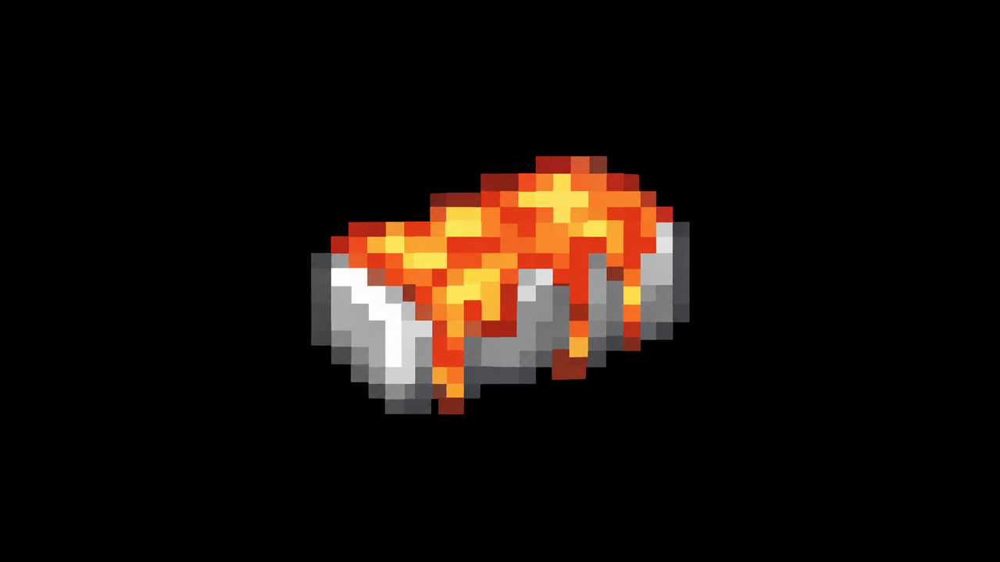

# IronTime 锻火

Folium 逐字歌词视觉：铁水浇筑、锤击迸火。

每一句歌词像刚出锻炉的钢件——字被烧红、落锤、火星四溅，然后逐字氧化、碎裂、掉落。纯渲染端模组，只提供 `client` 入口，播放、预览与透明导出都能用。



## 实机演示

Folia 内实录，30 秒，原片 1920×1080 / 60fps，仓库内为 720p 压缩版（3.4 MB）。

[观看演示视频](docs/showcase.mp4)

## 效果

**逐字时序**
每一句的开场字先被抛起、到位落锤，之后每个字按 `line.words` 的独立时间依次敲击。字离开后开始锈蚀：颜色由白热转橙红、再压暗成氧化铁，到末段碎裂成碎屑掉落。

**火花**
按真实锻打火花的形态建模，不是随机撒点：

| 形态 | 占比 | 表现 |
| --- | --- | --- |
| 流线（熔滴） | 58% | 拖尾光条 + 末端节花 + 冷却后收缩成球 |
| 爆花（分枝） | 18% | 先作为流线飞出，飞行中随机时刻炸成 2~4 条短流线，各自独立受重力 |
| 氧化皮碎屑 | 18% | 无规则多边形，暗、慢、翻滚，落地有概率二次迸射 |
| 铁鳞片 | 6% | 斜四边形薄片，纵向压扁模拟翻转 |

熔滴走加色混合（`lighter`）互相叠亮，氧化皮保持哑光覆盖——这是"铁水感"而不是"发光贴纸"的来源。

**冲击**
每个字落地生成双环冲击波（含抖动椭圆轮廓、白热光核、前 60ms 十字闪光）与地面扇形辉光，同时带一次弹簧震屏。重字是三级强度，轻字只有单环。

**后处理**
半分辨率离屏 Bloom 合成、径向暗角、环境余烬上飘。

## 安装

**模组市场**：在 Folium 的模组市场搜索 IronTime。

**手动安装**：把本仓库的文件放进 `%appdata%\Folia\mods\iron-time\`，目录名必须是 `iron-time`（与 `mod.json` 的 `id` 一致），目录内直接是 `mod.json`、`client.mjs`、`preview.png`。

```powershell
git clone https://github.com/voidkio/iron-time.git "$env:APPDATA\Folia\mods\iron-time"
```

改完代码后重启 Folia 生效。

## 设置项

共 19 项，按分组排列在模组的设置卡片里。

| 分组 | 设置 | 范围 | 默认 |
| --- | --- | --- | --- |
| 热控 | 辉光强度 `glow` | 0 ~ 2 | 2.00 |
| | 白热峰值 `peak` | 0 ~ 1 | 1.00 |
| | 冷却速度 `cool` | 0.5 ~ 2 | 0.70 |
| 火花 | 密度 `density` | 0 ~ 3 | 2.1 |
| | 重力 `gravity` | 200 ~ 1000 px/s² | 200 |
| | 初速 `speed` | 0.5 ~ 1.8 | 0.50 |
| | 余烬寿命 `life` | 0.5 ~ 2 | 2.00 |
| 冲击 | 震动强度 `shake` | 0 ~ 1 | 1.00 |
| | 冲击波 `shock` | 0 ~ 1.5 | 1.50 |
| | 节奏灵敏度 `rhythm` | 0 ~ 1 | 1.00 |
| 真实度 | 不对称度 `asym` | 0 ~ 1 | 1.00 |
| | 暗角收缩 `vig` | 0 ~ 1 | 0.60 |
| | Bloom 后处理 `bloom` | 开 / 关 | 开 |
| | Bloom 强度 `bloomStrength` | 0 ~ 1.5 | 0.75 |
| | 环境余烬 `ambient` | 开 / 关 | 开 |
| | 句首上抛动画 `firstToss` | 开 / 关 | 关 |
| 配色 | 配色 `palette` | 标准锻热 / 白热极限 / 冷淬 | 标准锻热 |
| 安全 | 减少动态 `reduce` | 开 / 关 | 关 |
| | 高频闪光限制 `flashLimit` | 开 / 关 | 关 |

`句首上抛动画` 关掉时，句首字改为原地压缩回弹的落锤；打开则恢复抛物线上抛。

## 兼容性

- Folia `>=0.7.21`
- Folium 契约版本 `1`

纯渲染端实现：原生 DOM + Canvas 2D + 弹簧积分，没有 React、没有第三方库、不读网络、不写文件、不申请任何权限。

## 实现要点

- 逐字时间取宿主 `line.words` 的 `startTime` / `endTime`，缺失时按整句均分兜底
- 宿主以行尾时间判定活性，模组侧按 `startTime` 提前 280ms 抢跑渲染，避免新句首字以完成态直接出现
- 粒子尺寸、初速、重力统一乘 `PX` 分辨率系数（1080p 全屏为 1.0），4K 与窗口化下观感一致
- 配色用预解析的 RGB 查找表，避免每帧解析颜色字符串
- 粒子总数上限 `MAX_PARTICLES = 3200`，超限时只截断新增、不强杀已有粒子，避免视觉跳变
- 同帧多字齐发时按 `FRAME_SPARK_BUDGET = 1200` 均分发射量，单词爆发不受影响，避免一帧内堆出上千粒子
- 震屏冲量限幅 `SHAKE_VMAX = 2000` px/s，多字同帧不会叠成整屏猛甩
- 火花寿命不超过当前行时长 × 0.9，片头、念白等短行不会把粒子拖进下一句
- Bloom 后处理每 3 帧重算一次，光晕最多滞后 50ms；跳过的帧复用上一份结果，画面不中断
- Canvas 状态与 `save` / `restore` 严格配对，`lineCap` 只在需要的分支内设置

## 许可证

[MIT](LICENSE)
